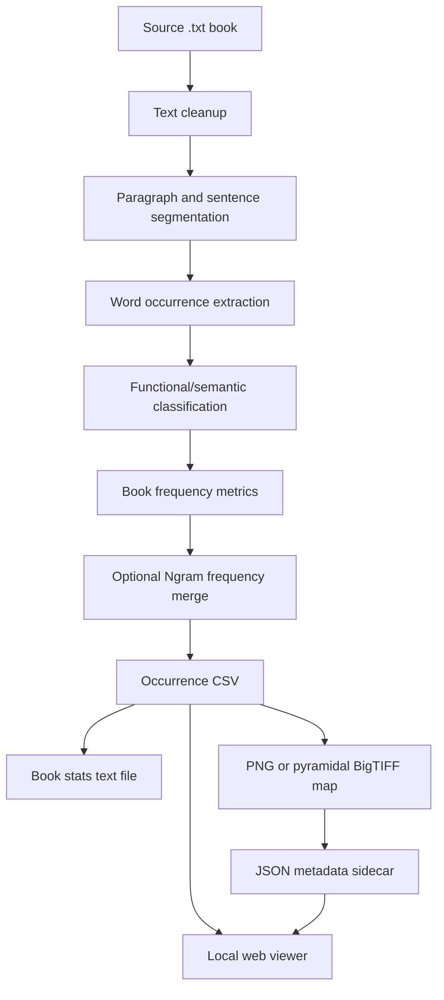

# Project Development Report: Vocabulary Diversity Visual Maps

Prepared from the local workspace state inspected on 2026-05-29. The newest project file timestamps observed in the workspace are from 2026-05-28.

## 1. Evidence Base and Scope

This report explains the project as it currently exists in `C:\Users\User\Documents\New project` and reconstructs the historical development process from local evidence.

Important limitation: there is no available Git history in this workspace. The root directory does not expose a `.git` folder, and the shell does not provide a usable `git` command. For that reason, the history below is not a commit-by-commit history. It is an inferred project history based on:

- Source and documentation files in `vocab_mapper`, `scripts`, `tests`, and the root documentation.
- Generated outputs in `output`, including occurrence CSVs, map metadata, rendered maps, plots, and book statistics.
- Data files in `data`, especially Google Ngram-derived frequency CSVs and cache files.
- Package artifacts such as `vocabulary_map_viewer_portable`, `advisor_viewer_bundle`, and `vocabulary_map_viewer_portable.zip`.
- File timestamps and package manifests.
- The local test suite and a test run attempted during this report preparation.

Where the report describes intention, architecture, and behavior, it is based on source code and documentation. Where it describes chronology, it is explicitly inferred from timestamps and artifacts.

## 2. Executive Summary

The project is a Python-based research and visualization system for mapping vocabulary behavior across full-length books. It converts book text files into word-occurrence CSVs, calculates book-level and corpus-level frequency/deviation metrics, renders those metrics into visual maps, and serves the maps through a local browser-based viewer.

At a high level, the project answers questions such as:

- Where does a book use common or rare words?
- How do word-frequency patterns vary across chapters, paragraphs, and sentences?
- How do functional words and semantic words behave differently?
- How does a book's vocabulary compare with Google Books English Fiction 2019 1-gram frequencies?
- How can large books be rendered as navigable visual maps without loading massive TIFF images directly into the browser?

The project has grown beyond a single script. It now includes:

- A text ingestion and occurrence extraction pipeline.
- A metric system with canonical metric names and legacy aliases.
- Book-level and Ngram-based frequency/deviation calculations.
- PNG and pyramidal BigTIFF map rendering.
- JSON metadata sidecars for rendered maps.
- Batch generation scripts.
- Ngram import and Ngram backfill utilities.
- A local HTTP viewer using Python's standard library for serving.
- A JavaScript canvas interface for browsing maps.
- Upload-based map generation from the viewer.
- Word-statistics CSV browsing.
- Portable/shareable viewer packages.
- A unit test suite covering parsing, metrics, rendering, batch discovery, and viewer generation behavior.

The project is research-oriented rather than a conventional application-only codebase. Large generated artifacts are central to its purpose. The workspace contains both source code and derived research output.

## 3. Project Purpose

The project's core purpose is to transform literary texts into visual representations of vocabulary distribution. Each word occurrence in a book becomes one row in an occurrence CSV. That row preserves:

- The exact word form from the book.
- The normalized lowercase word.
- The absolute word number.
- The functional or semantic word class.
- Sentence, paragraph, and chapter positions.
- Relative positions inside sentence, paragraph, and chapter.
- Book-frequency metrics.
- Google Ngram-derived corpus-frequency metrics when available.

The resulting CSV can then be rendered into visual maps. In those maps, each occurrence row is assigned a color based on a selected metric. For example:

- `book_freq` uses a black-to-white scale.
- Deviation metrics such as `book_avg_dev` and `fic_ngram_total_avg_dev` use a red-white-blue diverging scale.
- Negative deviation is red, zero is white, and positive deviation is blue.

This produces a compact visual object that lets a reader inspect changes in vocabulary distribution over the course of a book.

## 4. Research Model

The project uses two major vocabulary categories:

- `functional`: closed-class or grammar-heavy words such as articles, pronouns, conjunctions, auxiliaries, and prepositions.
- `semantic`: lexical content words, including most nouns, verbs, adjectives, adverbs, names, and other open-class words.

The distinction matters because function words and lexical words have very different natural frequency distributions. Without separation, very frequent function words can dominate visual scales and distort comparisons. The project calls this separation "class discrimination" or "class norm."

The viewer exposes a `Class norm` option so users can switch between class-discriminated and non-class-discriminated views.

## 5. Main Data Pipeline

The main pipeline is implemented primarily in `vocab_mapper.prepare_csv`.



### 5.1 Text Reading and Cleanup

The ingestion layer reads text using a fallback sequence of encodings: UTF-8 with BOM, UTF-8, CP1252, and Latin-1. It normalizes typographic punctuation, strips Project Gutenberg boilerplate when recognizable markers exist, collapses excess spaces, and normalizes blank lines.

This gives the project some tolerance for mixed source texts, public-domain downloads, and manually assembled book files.

### 5.2 Structural Segmentation

The extraction logic detects:

- Paragraphs using blank-line boundaries.
- Sentences using punctuation endings.
- Chapter starts using short headings matching patterns such as `CHAPTER I`, `BOOK II`, `PART 3`, or Roman numerals.

Every word occurrence receives:

- `sentence_number`
- `paragraph_number`
- `chapter_number`
- `position_in_sentence`
- `position_in_paragraph`
- `position_in_chapter`
- Relative position values for each of those scopes.

This is important because the maps are not only lists of words. They retain the book's internal structure, allowing the viewer to draw sentence, paragraph, and chapter markers.

### 5.3 Word Normalization

Words are matched with the regular expression used by `vocab_mapper.prepare_csv`, which accepts alphabetic words with internal hyphens and apostrophes. The normalized form is lowercase with outer apostrophes stripped.

The project does not currently use a full NLP tokenizer, lemmatizer, or part-of-speech tagger. Its design is intentionally simple and deterministic.

### 5.4 Word-Class Assignment

The project maintains a built-in `FUNCTION_WORDS` set. A normalized word found in that set is classified as `functional`; all other words are classified as `semantic`.

This makes the classification fast and reproducible, but it also means edge cases are not context-aware. For example, a word that can function as multiple parts of speech is classified only by string membership.

## 6. Metric System

The canonical metric definitions live in `vocab_mapper.metrics`.

### 6.1 Book Metrics

The core book metrics are:

- `book_freq`: word count divided by total word occurrences in the same word class when class discrimination is enabled.
- `book_avg_dev`: `(book_freq / avg_book_f) - 1`.
- `book_med_dev`: `(book_freq / med_book_f) - 1`.

The average and median denominators are computed over word frequencies in the active class grouping.

### 6.2 Fiction Ngram Metrics

The Google Ngram-derived metrics are:

- `fic_ngram_total_freq`
- `fic_ngram_total_avg_dev`
- `fic_ngram_total_med_dev`
- `fic_ngram_prepub_10y_freq`
- `fic_ngram_prepub_10y_avg_dev`
- `fic_ngram_prepub_10y_med_dev`
- `fic_ngram_99_19_freq`
- `fic_ngram_99_19_avg_dev`
- `fic_ngram_99_19_med_dev`

The three Ngram windows are:

- All available years in the English Fiction 2019 corpus.
- The ten years before a book's publication year, when publication-year data is available.
- The recent 1999-2019 window.

### 6.3 Excluded Historical Metrics

The code explicitly excludes median absolute deviation-style metrics such as `*_mad`. The reason documented in the project is that median absolute deviation removes sign, while the maps need direction: below-normal and above-normal values must remain visually distinct.

This is an important development decision. The project moved toward signed deviation metrics because the visual maps depend on directionality.

### 6.4 Legacy Compatibility

The metric layer includes aliases for earlier names such as:

- `book_frequency`
- `frequency_total_F`
- `book_frequency_average_deviation`
- `F_Ngrams_Total`
- `Ngrams_Total_frequency_average_deviation`
- `F_Ngrams_-10y`
- `F_Ngrams_1999-2019`

This shows that the project went through at least one naming migration. The current code preserves compatibility with earlier generated CSVs and map metadata.

## 7. Rendering Architecture

Rendering is implemented through two paths.

### 7.1 PNG and Custom BigTIFF Rendering

`vocab_mapper.plot_visual_map` handles row-to-color conversion and can render frequency maps. It contains color scaling functions, signed color interpolation, BigTIFF support helpers, and metadata generation logic.

### 7.2 Pyramidal Tiled BigTIFF Rendering

`vocab_mapper.plot_pyramidal_tiff` is the main scalable rendering path. It uses NumPy and tifffile to create tiled, compressed, pyramidal BigTIFF files.

The design is appropriate for books with hundreds of thousands or millions of rows because:

- Each word occurrence can be represented as a horizontal row.
- The base map can be thousands of pixels wide.
- Pyramid levels support efficient zoomed-out browsing.
- JSON sidecars allow the viewer to discover maps without parsing large TIFF content.

The metadata sidecar records fields such as:

- Input CSV path.
- Output TIFF path.
- Metric name.
- Metric definition.
- Scale type.
- Class discrimination state.
- Palette.
- Display width.
- Data row count.
- Minimum, maximum, and maximum absolute metric values.
- Pyramid format details.

## 8. Viewer Architecture

The local viewer is implemented in `vocab_mapper.viewer` and `vocab_mapper/web_viewer`.

### 8.1 Server

The Python server uses `ThreadingHTTPServer` and `SimpleHTTPRequestHandler`. It does not require Flask, FastAPI, Django, or another web framework.

Important endpoints include:

- `/api/maps`: scans and returns available map metadata.
- `/api/generation-options`: returns available corpora and metrics for uploaded text generation.
- `/api/generate`: accepts uploaded text content and produces occurrence CSVs, stats, and selected maps.
- `/api/maps/<id>/viewport`: returns visible row or binned color samples for the current viewport.
- `/api/maps/<id>/summary`: returns map summary statistics.
- `/api/word-stats`: lists available word-statistics CSVs.
- `/api/word-stats/<id>`: returns a selected word-statistics CSV.

### 8.2 Browser UI

The browser UI uses plain HTML, CSS, and JavaScript. The primary map viewer is canvas-based.

Main interface surfaces:

- `index.html`: upload/drop a local `.txt` file and generate maps.
- `viewer.html`: browse existing maps.
- `word-stats.html`: inspect saved word metric CSVs.
- `app.js`: canvas map viewer, zooming, navigation, overview, summary panel, and API calls.
- `upload.js`: upload/generation workflow.
- `word-stats.js`: word metrics table handling.
- `nav.js`: shared navigation.
- `style.css`: shared visual layout.

The viewer can:

- Fit a full map into the viewport.
- Restore one word occurrence per screen pixel.
- Zoom and scroll through a book.
- Draw sentence, paragraph, and chapter structure guides.
- Fetch binned samples when too many rows are visible.
- Show word labels when the rows are large enough.
- Toggle class normalization.
- Show a summary panel with bibliographic metadata, word counts, class ratios, metric statistics, and average rendered color.

## 9. Batch and Utility Scripts

The project includes several command-line utilities.

### 9.1 Batch Generation

`vocab_mapper.batch` scans `txt books` for `.txt` files and creates missing:

- Occurrence CSVs.
- First `book_freq` maps.
- Book stats files.

It supports dry runs, custom output directories, custom map directories, width selection, scale selection, and optional pre-publication Ngram stats.

### 9.2 Ngram Import

`vocab_mapper.import_ngram` reads Google Books 1-gram `.gz` data and `totalcounts-1`, filters to the target words appearing in a book, and writes compact frequency CSVs for:

- All years.
- A pre-publication window.
- 1999-2019.

This avoids needing full raw Ngram data during normal map generation.

### 9.3 Ngram Backfill

`scripts/add_missing_ngram_data.py` is a larger utility for populating missing Ngram columns across existing occurrence CSVs. It:

- Discovers CSV targets.
- Reads publication years from `txt books/Book List.xlsx`.
- Applies manual aliases and publication-year overrides.
- Builds caches for total and recent Ngram frequencies.
- Calculates book-specific pre-publication ranges.
- Writes updated occurrence CSVs with canonical metric columns.

### 9.4 Map Preparation

`scripts/prepare_ngram_maps.py` renders pyramidal TIFF maps across existing occurrence CSVs. It supports:

- Include/exclude filters.
- Metric groups: all, book, or Ngram.
- Repeated `--metric` selection.
- Optional parallel workers.
- Duplicate avoidance by book key and metric.

### 9.5 Statistical Plotting

The project contains plotting scripts for:

- Book frequency KDE plots by word class.
- Fiction Ngram corpus KDE plots.

The generated plot outputs include PNG files and JSON sidecars.

## 10. Repository and Workspace Structure

Key directories and files:

| Path | Purpose |
| --- | --- |
| `README.md` | Main project usage and metric documentation. |
| `ADVISOR_PACKAGE_README.md` | Portable viewer package explanation and sharing note. |
| `vocab_mapper/` | Main Python package. |
| `vocab_mapper/web_viewer/` | Static browser UI for the local viewer. |
| `scripts/` | Batch utilities, Ngram backfill, map preparation, plotting, and migration scripts. |
| `tests/` | Unit tests for CSV preparation, rendering, batch workflow, word metric outputs, and viewer generation. |
| `data/google_ngram/` | Raw Google Ngram files used for import/backfill. |
| `data/ngram_frequencies/` | Compact Ngram frequency CSVs and metadata. |
| `data/ngram_cache/` | Cached Ngram lookups for total/recent ranges. |
| `txt books/` | Source books and book-list metadata. |
| `output/CSV Ocurrence Maps/` | Generated occurrence CSVs. The folder name preserves the current project spelling. |
| `output/maps/` | Rendered TIFF maps and JSON metadata. |
| `output/book_stats/` | Per-book stats files. |
| `output/plots/` | KDE and supporting plot exports. |
| `output/Word_Metrics/` | Word-level metrics CSVs. |
| `output/source_texts/` | Viewer-uploaded source texts. |
| `vocabulary_map_viewer_portable/` | Shareable portable package. |
| `advisor_viewer_bundle/` | Earlier or alternate viewer bundle. |
| `vocabulary_map_viewer_portable.zip` | Zip distribution of the portable viewer. |

The project currently mixes source code and large generated research artifacts in one workspace. This is convenient for local analysis but should be handled carefully if the project is moved into version control.

## 11. Current Project Scale

Observed source and artifact scale:

- 36 source/test/static files across `vocab_mapper`, `scripts`, and `tests`.
- Approximately 7,758 lines across Python, JavaScript, HTML, and CSS in those source/test/static files.
- 28 Python source/test files in `vocab_mapper`, `scripts`, and `tests`.
- 4 JavaScript files, 3 HTML files, and 1 CSS file in the main active web viewer.
- 55 occurrence CSV files under `output/CSV Ocurrence Maps`.
- 555 map metadata JSON files under `output/maps`.
- 555 rendered `.tif` map files under `output/maps`.
- 99 PNG plot/map files under `output`.
- 57 text stats/log/source files under `output`.
- 10 compact Ngram frequency CSVs under `data`.
- 1 raw Google Ngram `.gz` file of approximately 940 MB.
- A portable package manifest reporting 885 included files and about 1.58 GB in `vocabulary_map_viewer_portable`.

The rendered map outputs are the dominant storage cost. The output directory contains multiple gigabytes of generated TIFF and CSV data.

## 12. Historical Development Process

Because no Git log is available, the timeline below is reconstructed from file timestamps and artifact evidence.

### Phase 1: Initial Project Seed, 2026-04-25

The earliest active project files in the current source tree appear on 2026-04-25:

- `vocab_mapper/__init__.py`
- `samples/sample_book.txt`
- `samples/sample_ngram.csv`
- `.gitignore`
- `txt books/The Fall of the House of Usher.txt`

This suggests the project began with a minimal package skeleton, sample inputs, a first real literary text, and basic ignore rules for Python caches and virtual environments.

An older virtual environment under `Vocabulary_maps/.venv` has timestamps from 2025-10-07. That appears to be an environment artifact rather than evidence of the current source code's start date.

### Phase 2: Local Environment and Corpus Expansion, 2026-04-26 to 2026-05-17

The local Codex environment file was created on 2026-04-26 with the environment name:

`IC: Mapping Word Frequency in Fictinoal Books`

The typo in "Fictinoal" is preserved in the environment file. The name confirms the research goal: mapping word frequency in fictional books.

During this broader period, the source corpus expanded. The `txt books` directory contains manually assembled or downloaded texts and metadata including:

- `Book List.xlsx`
- `book_txt_repository_matches.csv`
- `The Fall of the House of Usher.txt`
- `Harry Potter and the Sorcerer's Stone - US Version.txt`
- `Harry Potter and-the Philosophers Stone - UK Version.txt`
- `Lord of The Rings.txt`
- `Twilight.txt`
- `The Mysteries of Udolpho.txt`
- `The Odissey.txt`
- `Heated Rivalry (Game Changers).txt`
- `Murder on The Orient Express.txt`
- `Guards_ Guards_ by Terry Pratchett.txt`
- `George R. R. Martin_1996_A Game Of Thrones.txt`

This phase appears to have shifted the project from a single-book experiment toward a comparative corpus workflow.

### Phase 3: Core Pipeline Consolidation, 2026-05-23

The strongest concentration of source-code timestamps is 2026-05-23. Many core modules and tests were created or rewritten that day:

- `vocab_mapper/metrics.py`
- `vocab_mapper/prepare_csv.py`
- `vocab_mapper/plot_visual_map.py`
- `vocab_mapper/plot_pyramidal_tiff.py`
- `vocab_mapper/word_metrics_csv.py`
- `vocab_mapper/word_frequency_csv.py`
- `vocab_mapper/batch.py`
- `vocab_mapper/plot_annotated_map.py`
- `vocab_mapper/stats.py`
- `vocab_mapper/metric_values.py`
- Initial tests for CSV preparation, word metrics, word frequency CSVs, visual maps, pyramidal TIFFs, and batch workflow.

This phase looks like a major architectural consolidation. The project gained:

- Canonical metric definitions.
- Backward-compatible metric aliases.
- Exclusion of MAD-style metrics.
- Signed average and median deviation calculations.
- Class-discriminated frequency normalization.
- Structured occurrence CSV generation.
- Book stats generation.
- Pyramidal BigTIFF rendering.
- Tests for important pipeline behavior.

The output timestamps from the same date show large-scale generation of book stats and maps, especially for public-domain/Gutenberg-derived books. This indicates that the code was not only written but also exercised against a sizeable corpus.

### Phase 4: Visualization and Statistical Analysis Additions, 2026-05-23

Later on 2026-05-23, plotting and visualization support expanded:

- `scripts/plot_book_frequency_kde_by_word_class.py`
- `scripts/plot_fic_ngram_corpus_kde.py`
- `vocab_mapper/viewer_rendering.py`
- `scripts/open_lotr_napari.py`
- `scripts/migrate_occurrence_csv_metrics.py`

This suggests the project needed both:

- Additional statistical summaries beyond maps.
- Migration support for generated CSVs using older metric names.
- A rendering helper shared by the server-side viewer and map-generation logic.
- Exploratory large-image viewing support through Napari.

The presence of `viewer.stderr.log`, `napari.stdout.log`, and `napari.stderr.log` is consistent with experimentation around large visual outputs and image inspection.

### Phase 5: Ngram Import and Book-Specific Corpus Comparison, 2026-05-24

On 2026-05-24, `vocab_mapper/import_ngram.py` was updated. Output and data timestamps show active work around `Guards_ Guards_ by Terry Pratchett.txt` and Ngram frequency files.

The project gained the ability to:

- Read raw Google Books English Fiction 2019 1-gram files.
- Normalize Ngram tokens.
- Select only target words used in a book.
- Produce compact per-book frequency CSVs.
- Generate all-years, recent-years, and pre-publication comparison files.

This is a major conceptual step. The project stopped being only a within-book frequency visualizer and became a system for comparing book vocabulary against external historical corpus usage.

### Phase 6: Full Ngram Backfill and Mass Map Rendering, 2026-05-25

On 2026-05-25, two important scripts were added or updated:

- `scripts/prepare_ngram_maps.py`
- `scripts/add_missing_ngram_data.py`

The output timestamps show many occurrence CSVs and map metadata files produced shortly afterward, especially under:

- `output/CSV Ocurrence Maps/downloaded from gutenberg`
- `output/maps/downloaded from gutenberg`

This phase appears to have been a mass-production phase:

- Backfill missing Ngram columns.
- Use publication-year metadata for pre-publication windows.
- Cache total/recent Ngram frequencies.
- Generate multiple metric maps per book.
- Avoid duplicate maps for alternate CSV variants.
- Prepare data for browsing rather than only for one-off images.

The same date also produced the portable viewer package manifest:

- Package name: `vocabulary_map_viewer_portable`
- Created local time: `2026-05-25 14:33:48`
- File count: 885
- Size: 1,579,984,162 bytes
- Included occurrence CSVs: 54
- Included map metadata JSON files: 552

The package notes explicitly exclude large TIFFs, raw Ngram data, virtual environments, caches, logs, and source book text files. This shows a clear packaging decision: make the viewer shareable while reducing bulk and limiting sensitive/raw-source exposure.

### Phase 7: Viewer Generation and Upload Workflow, 2026-05-27 to 2026-05-28

The test file `tests/test_viewer_generation.py` was updated on 2026-05-27. The main viewer and web UI files were heavily updated on 2026-05-28:

- `vocab_mapper/viewer.py`
- `vocab_mapper/web_viewer/index.html`
- `vocab_mapper/web_viewer/viewer.html`
- `vocab_mapper/web_viewer/word-stats.html`
- `vocab_mapper/web_viewer/nav.js`
- `vocab_mapper/web_viewer/app.js`
- `vocab_mapper/web_viewer/upload.js`
- `vocab_mapper/web_viewer/word-stats.js`
- `vocab_mapper/web_viewer/style.css`

This phase moved the viewer from a passive browser of existing maps toward a fuller local application. It can now:

- Discover available Ngram corpora.
- Upload a local `.txt` file.
- Generate selected maps from the browser.
- Write source text copies, occurrence CSVs, book stats, TIFF maps, and metadata.
- Refresh and open the newly generated maps in the viewer.
- Browse word-statistics CSVs.

The latest generated source text in `output/source_texts` is:

`george_r_r_martin_1996_a_game_of_thrones_5bda80e20d.txt`

The latest generated maps under `output/maps/generated` are also for that uploaded A Game of Thrones text. This confirms that the viewer's upload/generation workflow has been used recently.

### Phase 8: Documentation Refresh, 2026-05-28

The root `README.md` was updated on 2026-05-28. It now documents:

- Occurrence CSV generation.
- Core columns.
- Book metrics.
- Fiction Ngram metrics.
- Class discrimination.
- Visual map rendering.
- Interactive viewer pages.
- Batch workflow.
- Ngram importing.
- KDE plotting.

This documentation reflects the mature state of the project after the viewer and Ngram workflows had been integrated.

## 13. Testing and Verification Status

The repository includes a meaningful unit test suite:

- `tests/test_prepare_csv.py`
- `tests/test_word_metrics_csv.py`
- `tests/test_word_frequency_csv.py`
- `tests/test_plot_visual_map.py`
- `tests/test_plot_pyramidal_tiff.py`
- `tests/test_batch.py`
- `tests/test_viewer_generation.py`

An attempted test run was performed with:

```powershell
py -3 -m unittest discover -s tests
```

Result:

- 10 tests were discovered.
- 6 tests executed successfully.
- 4 tests errored because rendering dependencies were not installed in the active Python environment.

Missing dependencies reported:

- `PIL` / Pillow
- `numpy`
- `tifffile`

The same issue occurred when trying the older workspace virtual environment at `Vocabulary_maps/.venv/Scripts/python.exe`.

The failures are environment/dependency failures, not assertion failures in the tested logic. The code itself also raises a clear runtime message for viewer generation when these rendering dependencies are unavailable:

`Map generation needs Pillow, NumPy, and tifffile installed.`

The project has `requirements-viewer.txt` listing:

- `Pillow`
- `numpy`
- `tifffile`

However, the current Python environments used during this report preparation did not have those packages installed.

## 14. Current Strengths

The project has several strong engineering qualities:

- Clear separation between occurrence extraction, metric definitions, metric value calculation, rendering, stats, and viewing.
- Canonical metric names with alias compatibility for older outputs.
- Support for both book-only metrics and Ngram-enriched metrics.
- Explicit class discrimination for functional and semantic words.
- Large-book support through pyramidal tiled BigTIFF output.
- JSON sidecars that make generated artifacts discoverable.
- Local web viewer that does not depend on a heavy web framework.
- Browser upload workflow that can generate maps from a new text file.
- Unit tests covering both small pure functions and higher-level workflows.
- Portable package work that separates shareable viewer data from raw source books and raw Ngram data.

## 15. Current Limitations and Risks

### 15.1 No Version-Control History in the Workspace

The current workspace does not expose Git history. This limits traceability, change review, and precise development chronology.

### 15.2 Dependency Setup Is Incomplete

The test suite and map generation require Pillow, NumPy, and tifffile, but the tested Python environments do not currently include them. The project has a requirements file, but there is no full `pyproject.toml`, `requirements-dev.txt`, or locked environment file in the root.

### 15.3 Generated Artifacts Are Very Large

The project output includes gigabytes of TIFFs and large CSVs. This is expected for the research workflow, but it means generated data should be carefully separated from source code if the project is placed under version control.

### 15.4 Text and Metadata Encoding Issues

`output/book_metadata.json` contains visible mojibake in several author names and publication-year ranges, such as corrupted en dashes and accented characters. This does not necessarily break the viewer, but it should be corrected for publication-quality reporting.

### 15.5 Naming Typos Are Now Part of the Workspace

The folder `output/CSV Ocurrence Maps` uses "Ocurrence" rather than "Occurrence." Because paths are referenced throughout generated artifacts and code, correcting this typo would require a careful migration.

The environment name also includes `Fictinoal`, preserving a typo in local metadata.

### 15.6 Word Classification Is Rule-Based

The functional/semantic split is based on a fixed function-word list. That is reproducible and fast, but it is not context-aware and does not model ambiguous words, named entities, lemmatization, or historical spelling variants.

### 15.7 Copyright and Sharing Constraints

Occurrence CSVs preserve the word sequence of source books. The portable package README correctly warns that distribution permissions should be checked before sharing CSVs derived from copyrighted texts.

## 16. Recommended Next Development Steps

### 16.1 Add Reproducible Environment Setup

Create a root-level dependency specification for the full project, not only the viewer:

- `pyproject.toml`, or
- `requirements.txt` plus `requirements-dev.txt`.

Include at least:

- Pillow
- NumPy
- tifffile
- Any plotting dependencies actually required by the KDE scripts.

Then re-run:

```powershell
py -3 -m unittest discover -s tests
```

### 16.2 Put Source Code Under Version Control

Initialize or restore Git tracking for source files, documentation, scripts, and tests. Exclude generated artifacts unless there is a specific reason to version them.

Recommended tracked areas:

- `vocab_mapper/`
- `scripts/`
- `tests/`
- `README.md`
- `ADVISOR_PACKAGE_README.md`
- `requirements*.txt`
- Small samples.

Recommended ignored areas:

- `output/`
- `data/google_ngram/`
- `data/ngram_cache/`
- `*.zip`
- `*.log`
- Virtual environments.
- `__pycache__/`

### 16.3 Split Source, Data, and Distribution Artifacts

The project would be easier to maintain with three clear zones:

- Source repository: code, tests, docs, sample data.
- Local research workspace: full outputs, raw Ngram data, source books.
- Distribution package: portable viewer plus allowed derived artifacts.

This would reduce accidental sharing of raw or copyrighted material.

### 16.4 Repair Metadata Encoding

Regenerate or clean `output/book_metadata.json` using UTF-8 consistently. Verify names such as Bronte, Mieville, and publication-year ranges containing en dashes.

### 16.5 Document Data Provenance

For every source book and generated CSV, document:

- Source URL or origin.
- Edition/version.
- Publication year used for pre-publication Ngram windows.
- Whether the text is public domain, copyrighted, or private research material.
- Whether it is safe to include in portable packages.

### 16.6 Add End-to-End Smoke Tests

After dependencies are installed, add a small end-to-end smoke test that:

1. Creates a tiny temporary `.txt` book.
2. Generates an occurrence CSV.
3. Writes stats.
4. Renders one small pyramidal map.
5. Reads the JSON metadata.
6. Exercises the viewer's `/api/maps`, `/api/maps/<id>/summary`, and `/api/maps/<id>/viewport` paths.

This would catch integration regressions between CSV generation, metric calculation, rendering, and viewer loading.

## 17. Conclusion

The project has evolved from an initial word-frequency mapping experiment into a substantial local research tool for literary vocabulary analysis. Its central achievement is the conversion of complete books into structured, metric-rich occurrence tables and scalable visual maps that can be browsed interactively.

The development process appears to have moved through these stages:

1. A small package and sample-text foundation.
2. Expansion to a multi-book corpus.
3. Consolidation of metric definitions and occurrence extraction.
4. Addition of class-discriminated book metrics.
5. Addition of Google Ngram corpus comparisons.
6. Large-scale generated maps and stats.
7. Portable package creation.
8. Local web viewer maturation, including upload-driven map generation and word-stat browsing.

The main technical risks are now operational rather than conceptual: reproducible dependency setup, source/data separation, metadata cleanup, version-control traceability, and careful handling of shareable outputs. Once those are addressed, the project will be much easier to reproduce, review, package, and present.
